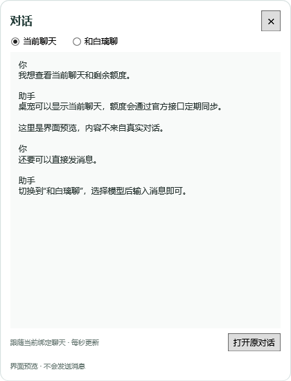
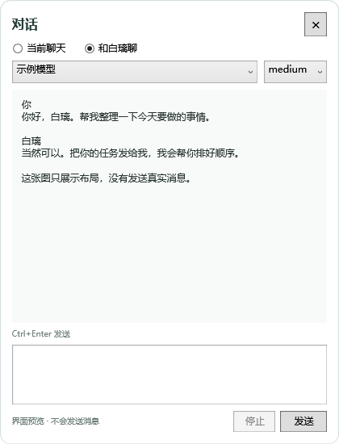
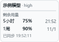

# 白璃桌宠 · BaiLi Companion

白发 Q 版桌面伙伴，提供 Codex 原生桌宠素材包和 Windows 独立增强版源码。增强版加入抓点惯性拖动、连续目光、随机互动，以及基于 Codex App Server 的对话和额度查看。


> **开发状态**：本仓库提供源码和素材，不包含预编译 EXE。最新增强版已完成编译，但开发环境的 Windows 应用程序控制拦截了最终候选程序，完整桌面验收尚未完成。独立官方 CLI 的 HTTPS/SSE 模型通路测试已成功；这不代表最新增强版已经通过端到端运行验收。

## 功能

| 功能 | 说明 |
| --- | --- |
| 抓点惯性拖动 | 以实际按住的位置为支点，快拖摆幅增大，急停回摆，松手逐渐回正；腿部保持站姿，摆角上限 24° |
| 连续目光 | 眼神连续跟随鼠标，独立于预设动画帧更新 |
| 靠近与待机 | 内置 8 组靠近组合，同一轮不重复；待机细节约每 33–105 秒随机出现 |
| 工作状态 | 128 帧托腮思考序列，头部与五官保持固定 |
| 清晰轮廓 | 保持原始动画帧，避免整张人物混帧产生双轮廓；稀疏素材仍按原始帧数播放 |
| 额度面板 | 左键打开 120×86 浮层，显示额度和观察时间；打开位置固定，点击其他位置或 Esc 关闭 |
| 查看当前聊天 | 约每秒读取绑定聊天的本地可见消息，保留最近 64 条、合计最多 1 MiB 文本 |
| 和白璃聊天 | 独立持久对话，支持模型与思考强度选择、流式回复、停止生成及登录入口 |
| 桌面行为 | 人物、额度、对话和设置窗口不显示任务栏项；托盘图标默认隐藏 |
| 后续扩展 | 可通过配置追加动作组合、图集和菜单入口 |

靠近和空闲组合会复用基础动画，不等于额外绘制了多套完整动作。连续眼神与物理摆动独立更新，不能将所有预设动画描述为 60fps。

## 两个版本的区别

| 版本 | 内容与边界 |
| --- | --- |
| 原生素材包 | 位于 `native/`。加入兼容客户端的“我的桌宠”，大小、聊天、语音、通知白条和隐藏由宿主管理 |
| 独立增强版 | 位于 `src/`。提供自定义物理、连续眼神、互动调度、独立对话与额度面板，需要单独构建和运行 |

原生包只提供素材和元数据，不能通过复制图集获得增强版的实时抓点物理或自定义代码。使用增强版时，可将原生角色设为 **Mini**，保留客户端白条并避免同时显示两个人物。白条联动依赖兼容的客户端窗口识别，仍需实机验证。

## 从源码构建增强版

要求：

- Windows 10/11 x64。
- .NET Framework 4.8，以及系统附带的 64 位 C# 编译器和 WPF 程序集。
- 对话与联网额度功能需要安装并登录 [Codex CLI](https://github.com/openai/codex)。仅使用形象与动画时不需要单独填写模型密钥。

在仓库根目录打开 PowerShell：

```powershell
git clone https://github.com/whst4564/desktop-pet.git
cd desktop-pet
.\scripts\build.ps1
```

构建输出到 `dist/`，包括 `BailiCompanion.exe`、匹配的 DLL、图像素材和默认设置。运行：

```powershell
.\dist\BailiCompanion.exe
```

构建脚本不会为程序签名。若本机或组织的应用程序控制策略拒绝运行新构建的程序，需要符合该策略的可信签名；本项目不修改系统安全策略。

运行时使用 `dist/settings.json`。首次构建从 `config/settings.example.json` 创建默认配置；修改后请保留 JSON 格式。不要将自己的运行配置或对话编号提交到仓库。

## 安装原生素材包

将这两个文件复制到同一个目标目录：

```text
native/pet.json
native/spritesheet.webp
```

目标目录为 `${CODEX_HOME}/pets/baili/`；未设置 `CODEX_HOME` 时，通常使用 `%USERPROFILE%\.codex\pets\baili\`。在客户端“设置 → 桌宠／我的桌宠”刷新并选择白璃。

本项目使用 v2 图集：1536×2288，单格 192×208，包含九种标准状态及十六方向注视素材。需要客户端支持该协议。原生移动状态保持固定提起站姿，不包含走路、踢腿或交叉步；实际事件与播放节奏由宿主控制。

## 操作

| 操作 | 行为 |
| --- | --- |
| 左键人物 | 打开或收起紧凑额度面板 |
| 拖动人物 | 抓点悬挂与惯性回摆，松手回正 |
| 右键 → 设置 | 调整大小；宽度滑条为 80–224，重置为 112，可跟随原生大小 |
| 右键 → 对话与模型 | 查看绑定聊天，或切换到“和白璃聊” |
| Ctrl+Enter | 发送桌宠聊天中的消息 |
| 停止 | 请求中断桌宠当前回复 |
| Esc | 关闭当前浮层或对话窗口 |

### 当前聊天与独立对话

“当前聊天”显示本地已经写入的用户消息和助手可见回复，约每秒读取新增记录，较早内容会省略。它不是原聊天的逐字事件流，也不读取主客户端未发送的输入。

“和白璃聊”使用单独的对话。首次发送后保存会话编号，重启时尝试载入；不会自动复制当前工作聊天的全部上下文，也不会向正在工作的原聊天插入消息。

如果尚未登录，点击“登录 Codex”，在官方页面完成操作。认证与令牌续期由 Codex CLI 管理，桌宠不直接读取或复制认证令牌。模型目录由服务器返回，实际可用性取决于账号、工作区和该次请求；列表中出现模型名称不等于推理权限已经验证。

### 额度与模型来源

额度优先通过官方 `account/rateLimits/read` 读取。打开面板或手动刷新时请求更新，后台约每 30 秒同步，收到额度通知时也会更新。界面保留观察时间、缓存和未知状态；过期或缺失的记录不会被推算成满额。

小面板的模型来自绑定任务最近的运行记录，不能确认主客户端尚未发送的模型选择。“和白璃聊”的模型选择器决定桌宠下一条消息使用的模型。

连接使用 [Codex App Server](https://learn.chatgpt.com/docs/app-server) 的本地 stdio JSON-RPC，启动隐藏的官方 CLI 子进程。为适应 WebSocket 连接受限的环境，连接层通过公开配置读取识别提供商，并只对自己的子进程选择 HTTPS/SSE；不改写全局 Codex 配置、认证、代理或提供商选择。

## 界面预览

以下截图使用实际 WPF 控件和合成示例数据，不含真实聊天或账号信息，也不是最终候选程序的桌面验收录像。

| 当前聊天 | 独立模型对话 |
| --- | --- |
|  |  |



## 配置与扩展

| 字段 | 用途 |
| --- | --- |
| `CodexHome` | 可选，指定 Codex 数据目录；未填写时使用环境变量 `CODEX_HOME` 或用户默认目录 |
| `CodexExecutable` | 可选，指定 Codex CLI 的真实 `.exe` 路径；未填写时自动查找安装位置及 PATH |
| `PreferredThreadId` | 只读聊天及任务状态的来源；`null` 时跟随最近记录的桌面任务 |
| `ChatThreadId` | 桌宠自身对话编号，由程序保存；不要填入正在工作的原聊天编号 |
| `FollowNativeSize` | 是否跟随原生桌宠大小 |
| `AttachNativeControls` | 是否尝试与原生 Mini 白条一起移动 |
| `ShowTrayIcon` | 是否显示托盘图标，默认关闭 |
| `SpriteClips` | 注册额外的单行透明图集 |
| `InteractionGroups` | 在内置靠近动作之外追加动作组合 |
| `Actions` | 添加右键菜单入口 |

扩展图集使用单行等宽格，组合中的 clip 必须已经存在，整组时长应为 2–4 秒。更改调度、逐帧时间或增加交互事件，需要修改 C# 源码。

```text
src/                    WPF 桌宠、动画、连接与读取逻辑
tests/                  物理、几何、调度、连接和读取检查
assets/enhanced/        增强版图集与图标
native/                 原生桌宠元数据与无损图集
config/                 不含个人信息的配置示例
scripts/                构建脚本
docs/images/            形象与合成界面预览
dist/                   本机构建输出，不提交
```

## 验证状态与已知限制

- 对话读取器的 26 项合成检查通过。
- HTTP 传输调整前的连接层通过 28 项模拟 stdio 协议检查；调整后的 32 项测试已编译，但在开发环境中被 Windows 应用程序控制阻止执行，不能标为通过。
- 较早候选程序通过 105 个实际素材采样检查，过渡采样与单张原图一致；保留了惯性、目光和思考的绘制检查。
- 独立官方 CLI 通过 HTTPS/SSE 完成了一次简短模型回复。这验证了后端通路，不能代替被拦截的最新 C# 程序验收。
- 最新增强版尚需可信签名和完整桌面验收，包括实际拖动、原生白条联动、多屏缩放、浮层关闭及桌面合成器中的拖影观感。

仓库不包含开发者本机的账号凭据、真实对话、额度快照、测试生成记录、个人运行配置或预编译可执行文件。

## 项目归属与授权

本项目是个人桌宠作品，与 OpenAI 无隶属或官方背书关系。形象包含 OpenAI 标识元素，相关名称与商标权利属于各自权利人。

仓库暂未指定开源许可证；代码和图像素材的再分发授权范围应在后续发布前明确。
